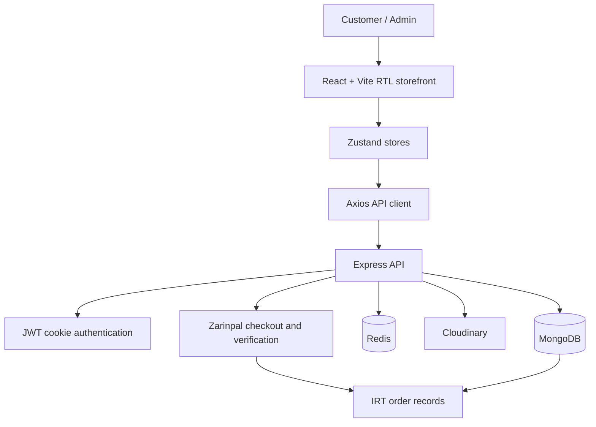

<div align="center">

# Tik Boutique

**A Persian-first, right-to-left commerce platform built for Iranian shoppers.**

A production-focused MERN storefront with whole-Toman pricing, Zarinpal checkout, inventory safeguards, order tracking, and tools for customers and store administrators.

<p>
  <a href="https://github.com/ItsWanheda/mern-ecommerce/actions/workflows/ci.yml"></a>
  <a href="https://github.com/ItsWanheda/mern-ecommerce/blob/master/LICENSE"></a>
  
  
</p>
<p>
  
  
  
  
  
</p>

[Features](#-features) · [Architecture](#-architecture) · [Setup](#-getting-started) · [Environment](#-environment-variables) · [API](#-api-reference) · [Deployment](#-deployment) · [Testing](#-testing-and-migrations)

</div>

## ✨ Features

### 🛒 Persian storefront
- Persian-first right-to-left (RTL) layout, navigation, product discovery, and category browsing.
- Responsive home, shop, category, product-detail, cart, wishlist, account, and order-history experiences.
- Customer profile editing and saved delivery-address management, including a direct **«پروفایل و نشانی‌ها»** link in the mobile hamburger menu.
- Product variants, stock availability, recommendations, coupons, campaigns, and newsletter subscription management.
- Toman-only price formatting with whole-Toman validation.

### 💳 Checkout and inventory
- **Zarinpal is the only payment provider.**
- **IRT (Toman) is the only storefront and order currency.**
- Server-side price, coupon, shipping, and inventory checks before initiating checkout.
- Inventory reservation, safe release, idempotent paid-order finalization, and scheduled recovery of uncertain payment results.
- Checkout rejects unknown or missing stock quantities; null stock is not interpreted as unlimited inventory.
- Payment status verification is performed server-side; the browser redirect alone is not treated as proof of payment.

### 🚚 Orders and fulfillment
- Iranian delivery-address validation and an address snapshot stored with each new order.
- Customer order history and shipment events.
- Admin shipment queue with guarded status transitions and carrier/tracking-code requirements.
- Product, category, campaign, coupon, customer, and fulfillment management, plus inventory alerts, service requests, analytics, and an administrative audit log.
- An operational dashboard for payment, shipment, database, and Redis signals.

### 🔐 Security and reliability
- HTTP-only authentication cookies and role-protected administrative routes.
- Explicit security headers, exact-origin CORS allowlisting, origin/Fetch Metadata checks, and API rate limits.
- Strong password creation and reset policy, including common-pattern rejection and bcrypt input-length protection.
- Category and campaign Base64 uploads are validated and stored as HTTPS Cloudinary URLs.
- Persian/Arabic character and digit normalization for product search.
- Lazy-loaded frontend routes and admin sections to reduce initial JavaScript work.

## 🧭 Architecture

The frontend communicates with an Express API. MongoDB stores users, products, carts, orders, campaigns, shipping settings, and audit events. Redis supports sessions and distributed rate limiting; Cloudinary stores product imagery. Checkout and payment verification use Zarinpal.



### Payment flow

1. The authenticated customer submits cart contents and a validated delivery address.
2. The backend reloads product prices, validates whole-Toman amounts, checks the coupon and shipping configuration, and reserves tracked inventory atomically.
3. The backend creates a pending IRT order and requests checkout from Zarinpal.
4. The callback is verified with the provider from the backend. Ambiguous provider/network results remain pending for reconciliation rather than releasing stock prematurely.
5. Successful payment finalizes the order idempotently. The reconciliation job retries incomplete or uncertain states.

## 🧰 Technology stack

| Area | Technologies |
| --- | --- |
| Frontend | React, Vite, Tailwind CSS |
| Routing and state | React Router, Zustand |
| Components and feedback | Lucide React, Framer Motion, React Hot Toast |
| API | Node.js, Express |
| Database | MongoDB, Mongoose |
| Session and rate-limit support | Redis, ioredis |
| Product imagery | Cloudinary |
| Payment | Zarinpal |
| Hosting options | Vercel or self-managed Node.js/static hosting |

## 🗂️ Project structure

```text
mern-ecommerce/
├── backend/
│   ├── api/                 # Serverless API entry point
│   ├── controllers/         # Auth, products, cart, checkout, orders, admin
│   ├── lib/                 # Database, Redis, shipping, search, audit
│   ├── middleware/          # Auth, rate limiting, security/CORS
│   ├── models/              # User, product, order, campaign, audit, settings
│   ├── routes/              # Express API route modules
│   ├── tests/               # Currency, search, security, recovery tests
│   ├── app.js
│   └── package.json
├── frontend/
│   └── src/
│       ├── components/
│       ├── pages/
│       ├── stores/
│       └── lib/             # API and commerce helpers
├── docs/
│   ├── PERSIAN_COMMERCE_OVERVIEW.md
│   ├── PERSIAN_COMMERCE_SETUP.md
│   ├── admin-expansion-requirements.md
│   ├── password-recovery.md
│   └── seo-share-previews.md
├── scripts/
│   ├── audit-untracked-inventory.mjs
│   ├── backfill-persian-search.mjs
│   ├── migrate-categories.mjs
│   ├── migrate-coupons.mjs
│   ├── migrate-orders-to-zarinpal-only.mjs
│   └── reconcile-pending-payments.mjs
├── package.json
└── package-lock.json
```

## 🚀 Getting started

### Prerequisites

- Node.js 20 or newer and npm.
- MongoDB. Use a replica set or compatible managed deployment for production inventory transactions.
- Redis for refresh-token storage and distributed rate limiting.
- Cloudinary credentials for product image uploads.
- A Zarinpal merchant configuration; keep sandbox mode enabled while validating checkout.

### 1. Install dependencies

Run from the repository root:

```bash
npm ci
npm ci --prefix frontend
```

### 2. Configure environment variables

Create a local environment file that is not committed to Git. Use the backend values below, then add `VITE_API_URL` to the frontend environment only when the API is not reachable through the same-origin `/api` path.

```dotenv
NODE_ENV=development
PORT=5000
MONGO_URI=mongodb://127.0.0.1:27017/mern-ecommerce
REDIS_URL=redis://127.0.0.1:6379
ACCESS_TOKEN_SECRET=replace_with_a_long_random_secret
REFRESH_TOKEN_SECRET=replace_with_a_different_long_random_secret
CLOUDINARY_CLOUD_NAME=your_cloud_name
CLOUDINARY_API_KEY=your_api_key
CLOUDINARY_API_SECRET=your_api_secret
ZARINPAL_MERCHANT_ID=your_merchant_id
ZARINPAL_SANDBOX=true
IRT_CATALOG_PRICES_CONFIRMED=false
API_URL=http://localhost:5000
CLIENT_URL=http://localhost:5173
DEFAULT_SHIPPING_FEE=0
FREE_SHIPPING_THRESHOLD=0
CRON_SECRET=replace_with_a_long_random_secret
```

For a separate frontend/API deployment, set the frontend build variable:

```dotenv
VITE_API_URL=https://your-api.example/api
```

Never put backend credentials or payment secrets in a variable prefixed with `VITE_`.

### 3. Verify the catalogue before checkout

The backend intentionally rejects checkout until `IRT_CATALOG_PRICES_CONFIRMED=true`. First audit and update every sellable product price, shipping fee, and free-shipping threshold to approved whole-Toman values. Do not simply change currency labels or apply an assumed conversion rate to existing catalogue values.

### 4. Start development servers

Terminal 1 — API:

```bash
npm run dev
```

Terminal 2 — frontend:

```bash
npm run dev --prefix frontend
```

Open [http://localhost:5173](http://localhost:5173). The API health endpoint is [http://localhost:5000/api/health](http://localhost:5000/api/health); it confirms the application process responds, not that every dependency is healthy.

## 🔑 Environment variables

| Variable | Purpose |
| --- | --- |
| `NODE_ENV` | Runtime environment; set to `production` on production deployments. |
| `PORT` | Local/backend listener port. |
| `MONGO_URI` | MongoDB connection string. |
| `REDIS_URL` | Redis connection string. The older `UPSTASH_REDIS_URL` is accepted for compatibility. |
| `ACCESS_TOKEN_SECRET` | Signing secret for short-lived access cookies. |
| `REFRESH_TOKEN_SECRET` | Separate signing secret for refresh cookies. |
| `CLOUDINARY_CLOUD_NAME`, `CLOUDINARY_API_KEY`, `CLOUDINARY_API_SECRET` | Product media configuration. |
| `ZARINPAL_MERCHANT_ID` | Merchant identifier configured by the payment provider. |
| `ZARINPAL_SANDBOX` | Keep `true` during integration testing; disable only after live readiness checks. |
| `IRT_CATALOG_PRICES_CONFIRMED` | Must remain `false` until catalog/shipping prices have been verified in Toman. |
| `API_URL` | Public backend origin used to construct the payment callback. |
| `CLIENT_URL` | Exact storefront origin used for redirects and origin allowlisting. |
| `CORS_ALLOWED_ORIGINS` | Optional comma-separated list of additional exact frontend origins. |
| `DEFAULT_SHIPPING_FEE`, `FREE_SHIPPING_THRESHOLD` | Whole-Toman shipping settings. |
| `CRON_SECRET` | Long random secret authorizing payment reconciliation. |
| `VITE_API_URL` | Optional public frontend build variable for a separately hosted API. Never use it for secrets. |
| `VITE_STORE_INSTAGRAM_URL`, `VITE_STORE_TELEGRAM_URL`, `VITE_STORE_X_URL` | Optional public profile links shown as social icons in the footer. Use the store's real HTTPS profile URLs. |
| `VITE_ENAMAD_SEAL_IMAGE_URL` | Public image/embed URL for the eNAMAD seal issued to this specific store. |
| `VITE_ENAMAD_SEAL_LINK_URL` | Official eNAMAD verification link issued for this store. Do not substitute a generic eNAMAD homepage URL. |

The footer reads the public variables above at build time. The social icons remain inactive until real profile URLs are configured. Until the shop's own eNAMAD seal image and verification URL are configured, the footer labels the displayed generic mark as unverified; a generic logo is not evidence that this store has an active trust seal. Update the frontend environment and redeploy after changing these values.

## 🧱 Data and currency rules

- New order records use `currency: "IRT"` and `paymentProvider: "zarinpal"`.
- Product and shipping prices must be whole-Toman numeric values.
- The gateway amount is supplied in Rial, so the backend converts the verified Toman amount to Rial at the payment boundary.
- The frontend has no alternate currency selection or formatting path.
- Records that do not contain explicit IRT/Zarinpal metadata are not included in the active order history. The migration preserves their order documents and amount fields; it does not attempt an unapproved currency conversion.

Before deploying this version to an existing database, take a verified backup and run the one-time database migration described in [Persian commerce setup](docs/PERSIAN_COMMERCE_SETUP.md). The migration removes obsolete checkout-session indexes/metadata so they cannot interfere with new orders.

## 🌐 API reference

All routes are prefixed with `/api`.

| Method | Endpoint | Access | Purpose |
| --- | --- | --- | --- |
| `GET` | `/health` | Public | Process health probe. |
| `GET` | `/ready` | Public | Database readiness probe. |
| `POST` | `/auth/signup` | Public | Create a customer account. |
| `POST` | `/auth/login` | Public | Authenticate and set cookies. |
| `POST` | `/auth/logout` | Session | Clear authentication cookies. |
| `POST` | `/auth/refresh-token` | Session | Refresh the access session. |
| `GET` | `/auth/profile` | Authenticated | Read the current user profile and saved addresses. |
| `PATCH` | `/auth/profile` | Authenticated | Update profile information. |
| `PATCH` | `/auth/profile/default-address` | Authenticated | Save/update the legacy default delivery address. |
| `POST` | `/auth/profile/addresses` | Authenticated | Add a saved delivery address. |
| `PATCH` | `/auth/profile/addresses/:addressId` | Authenticated | Edit a saved delivery address. |
| `PATCH` | `/auth/profile/addresses/:addressId/default` | Authenticated | Make a saved address the default. |
| `DELETE` | `/auth/profile/addresses/:addressId` | Authenticated | Delete a saved delivery address. |
| `GET` | `/products` | Admin | List products for management. |
| `GET` | `/products/featured` | Public | List featured products. |
| `GET` | `/products/category/:category` | Public | Browse a product category. |
| `POST` | `/cart` | Authenticated | Add a product/variant to the cart. |
| `PUT` | `/cart/:id` | Authenticated | Update a cart line quantity. |
| `DELETE` | `/cart` | Authenticated | Remove cart lines or empty the cart. |
| `GET` | `/payments/provider` | Public | Read the active payment configuration. |
| `POST` | `/payments/create-checkout` | Authenticated | Validate cart and start checkout. |
| `GET` | `/payments/zarinpal/verify` | Provider callback | Verify payment result. |
| `GET` | `/payments/zarinpal/order/:orderId` | Authenticated | Read owned order payment status. |
| `GET` | `/payments/reconcile-pending` | Scheduler secret | Recover uncertain payment/order state. |
| `GET` | `/orders/mine` | Authenticated | List active IRT orders and tracking. |
| `GET` | `/orders/admin` | Admin | List paid orders for fulfillment. |
| `PATCH` | `/orders/:id/shipment` | Admin | Update shipment state and tracking. |
| `GET` | `/admin/audit-logs` | Admin | Review administrator actions. |
| `GET` | `/admin/operations` | Admin | Read operational snapshot metrics. |

The complete route definitions and request validation are in `backend/routes/` and `backend/controllers/`.

## 🚢 Deployment

### Before production

1. Back up the database and verify you can restore it.
2. Update product prices, shipping settings, and thresholds to approved whole-Toman amounts.
3. Run the order-metadata/index migration against the intended database after checking `MONGO_URI`.
4. Configure production secrets in the host's secret manager; do not store secrets in Git.
5. Set exact `CLIENT_URL` and `CORS_ALLOWED_ORIGINS` values. Avoid wildcard credentialed CORS.
6. Use HTTPS and configure the trusted reverse proxy to forward the original scheme.
7. Use a MongoDB replica set or transaction-capable managed deployment for atomic inventory recovery.
8. Validate Zarinpal sandbox request, redirect, callback, failed request, timeout, duplicate callback, and reconciliation flows.
9. Configure the reconciliation scheduler and alert on repeated failures.
10. Enable `IRT_CATALOG_PRICES_CONFIRMED=true` only after catalogue verification.

### Payment reconciliation

The callback may be delayed or the provider/network response may be ambiguous. Production reconciliation must run about every five minutes using `GET /api/payments/reconcile-pending` with the `Authorization: Bearer <CRON_SECRET>` header. The repository includes `.github/workflows/reconcile-payments.yml`; configure the repository Actions secrets `PAYMENTS_API_URL` (public API origin without `/api`) and `CRON_SECRET` (same value as the backend secret). Vercel Cron is intentionally not configured in `backend/vercel.json` because Hobby plans do not support the required interval. Self-hosted deployments can use `scripts/reconcile-pending-payments.mjs` and the Linux cron example in [Persian commerce setup](docs/PERSIAN_COMMERCE_SETUP.md). Configure only one routine scheduler.

## 🧪 Testing and migrations

Build and test from the repository root:

```bash
npm run build
npm test
npm test --prefix backend
```

The backend suite covers IRT/Zarinpal policy, Persian search normalization, security headers/origin checks, and inventory reservation/recovery. Inventory integration tests need a dedicated disposable database configured through `MONGO_TEST_URI`; use a replica set for transaction-specific tests. Never point it to production or any database containing real orders.

To backfill normalized search text for existing products:

```bash
node scripts/backfill-persian-search.mjs
```

For existing order collections, take a verified backup and follow the guarded migration procedure in [Persian commerce setup](docs/PERSIAN_COMMERCE_SETUP.md).

## 🔒 Security notes

- Use unique, randomly generated authentication and scheduler secrets.
- Keep MongoDB and Redis private and restrict network access.
- Never expose Cloudinary/payment credentials through frontend build variables.
- Run production behind HTTPS; configure the reverse proxy and cookie behavior deliberately.
- Treat build/test results and live environment verification as separate release checks.

---

<div align="center">

**Made for a Persian-first shopping experience.**

[Project](https://github.com/ItsWanheda/mern-ecommerce) · [Setup guide](docs/PERSIAN_COMMERCE_SETUP.md) · [License](LICENSE)

<sub>Built with React, Node.js, Express, MongoDB, and Redis.</sub>

</div>
