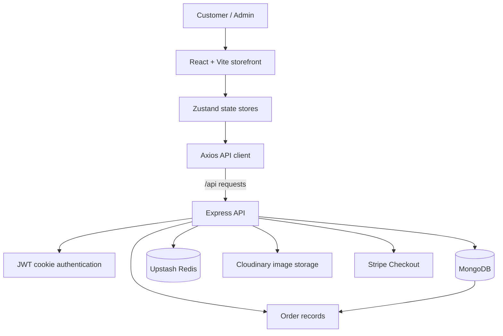

# Current Persian-commerce implementation

> **Active branch documentation:** This feature migrates checkout to Zarinpal and whole-Toman (IRT) pricing. The historical README retained below describes the original Stripe/USD implementation and is **not** the active payment configuration for this branch. Use the [Persian Commerce Overview](docs/PERSIAN_COMMERCE_OVERVIEW.md) and [Persian Commerce Setup](docs/PERSIAN_COMMERCE_SETUP.md) for current features, required data migrations, configuration, and operational checks.

---

<div align="center">

# 🛍️ MERN E-Commerce Store

**A full-stack shopping experience powered by MongoDB, Express, React, and Node.js.**

A modern storefront with account authentication, a persistent cart, coupon validation, Stripe Checkout, product management, and sales analytics.

<p>
  <a href="https://github.com/ItsWanheda/mern-ecommerce"></a>
  <a href="https://github.com/ItsWanheda/mern-ecommerce/blob/master/LICENSE"></a>
  <a href="https://github.com/ItsWanheda/mern-ecommerce"></a>
</p>
<p>
  
  
  
  
  
  
</p>

[Features](#-features) · [Architecture](#-architecture) · [Getting Started](#-getting-started) · [Environment](#-environment-variables) · [API](#-api-reference) · [Deployment](#-deployment) · [Security](#-security-and-production-notes)

</div>

---

## 📚 Table of Contents

- [Features](#-features)
- [Architecture](#-architecture)
- [Technology Stack](#-technology-stack)
- [Project Structure](#-project-structure)
- [Getting Started](#-getting-started)
- [Environment Variables](#-environment-variables)
- [Data Models](#-data-models)
- [API Reference](#-api-reference)
- [Deployment](#-deployment)
- [Payments and Currency](#-payments-and-currency)
- [Troubleshooting](#-troubleshooting)
- [Security and Production Notes](#-security-and-production-notes)
- [Credits](#-credits)

## ✨ Features

### 🛒 Storefront and product discovery
- **Storefront pages** for browsing featured items, categories, product details, and product recommendations.
- **Product catalog** with names, descriptions, prices, categories, image URLs, and featured status.
- **Product imagery** uploaded to Cloudinary through the product-management flow.
- **Responsive React interface** styled with Tailwind CSS, with icons, animated UI elements, notifications, and charts.

### 🧺 Cart and coupons
- **User-specific shopping cart** stored with the user's account in MongoDB.
- Add products, change quantities, remove individual products, or clear the cart.
- Calculate cart subtotals and totals in the frontend.
- Retrieve and validate active coupons assigned to a user.
- Validate cart items against current product records before creating a checkout session.

### 🔐 Accounts and authentication
- Sign up, log in, and log out.
- Password hashing using bcryptjs.
- Short-lived JWT access tokens and longer-lived refresh tokens.
- Tokens stored in **HTTP-only cookies**; refresh tokens are stored in Redis with an expiration.
- Access-token refresh flow for authenticated requests.
- Role-based protection for administrative operations.

### 💳 Checkout and orders
- Create Stripe Checkout sessions from the signed-in user's cart.
- Apply eligible coupons during checkout.
- Redirect to purchase-success or purchase-cancel pages.
- Verify the Checkout session and payment status before recording an order.
- Prevent duplicate order records for a previously processed Stripe session.

### 📊 Admin and analytics
- Admin dashboard protected by the user's `admin` role.
- Create and delete products and toggle their featured status.
- Review aggregate user, product, sales, and revenue metrics.
- View daily sales and revenue data for a recent date range.

> **Role assignment:** New accounts receive the `customer` role by default. There is no public endpoint for promoting an account to administrator; admin access must be granted through a trusted administrative process.

## 🧭 Architecture

The application is divided into a React/Vite frontend and an Express API backed by MongoDB. Redis supports refresh-token storage and featured-product caching; Cloudinary stores uploaded product images; Stripe handles payment checkout.



### Main application flows

1. **Authentication:** The user signs up or logs in. The API validates the credentials, sets access and refresh cookies, and stores the refresh token in Redis.
2. **Shopping:** The frontend retrieves product data from the API and uses Zustand stores to manage cart and user interface state. Cart contents are persisted against the user record.
3. **Checkout:** The API reads current product prices from MongoDB, creates a Stripe Checkout session, and provides the success/cancel redirect URLs.
4. **Order confirmation:** After checkout, the frontend asks the API to verify the Stripe session. The API checks ownership and payment status before recording the order and clearing the cart.
5. **Administration:** Authenticated users with the `admin` role can manage products and access analytics endpoints.

## 🧰 Technology Stack

| Layer | Tools | Responsibility |
| --- | --- | --- |
| Frontend | React 18, Vite | User interface and frontend build |
| Styling and UI | Tailwind CSS, Lucide React, Framer Motion | Styling, icons, and animation |
| Routing and state | React Router, Zustand | Page navigation and client-side state |
| HTTP and feedback | Axios, React Hot Toast | API requests and user notifications |
| Charts | Recharts | Analytics visualizations |
| Backend | Node.js, Express 4 | API routes and business logic |
| Database | MongoDB, Mongoose | Users, products, coupons, cart data, and orders |
| Authentication | JSON Web Tokens, bcryptjs, HTTP-only cookies | Sessions and password protection |
| Cache | Upstash Redis, ioredis | Refresh-token storage and featured-product cache |
| Image storage | Cloudinary | Uploaded product images |
| Payments | Stripe Checkout | Checkout session and payment verification |
| Hosting configuration | Vercel | Frontend build, API entry point, and rewrites |

## 🗂️ Project Structure

```text
mern-ecommerce/
├── backend/
│   ├── api/
│   │   └── index.js                 # Serverless API entry point
│   ├── controllers/
│   │   ├── analytics.controller.js  # Sales and revenue analytics
│   │   ├── auth.controller.js       # Signup, login, logout, token refresh
│   │   ├── cart.controller.js       # Persistent cart operations
│   │   ├── coupon.controller.js     # Coupon retrieval and validation
│   │   ├── payment.controller.js    # Stripe Checkout and order confirmation
│   │   └── product.controller.js    # Catalog and product management
│   ├── lib/
│   │   ├── cloudinary.js            # Cloudinary client
│   │   ├── db.js                    # MongoDB connection
│   │   ├── redis.js                 # Redis client
│   │   └── stripe.js                # Stripe client
│   ├── middleware/
│   │   └── auth.middleware.js       # Authentication and admin authorization
│   ├── models/
│   │   ├── coupon.model.js
│   │   ├── order.model.js
│   │   ├── product.model.js
│   │   └── user.model.js
│   ├── routes/                      # Express route modules
│   ├── app.js                       # Express app and API route mounting
│   ├── server.js                    # Local Node.js server
│   └── package.json
├── frontend/
│   ├── public/                      # Static images and README screenshot
│   ├── src/
│   │   ├── components/              # Reusable UI components
│   │   ├── pages/                   # Store, account, cart, and admin pages
│   │   ├── stores/                  # Zustand user, product, and cart stores
│   │   ├── lib/axios.js             # Shared Axios instance
│   │   ├── App.jsx                  # Application routes
│   │   └── main.jsx                 # React entry point
│   ├── package.json
│   └── vite.config.js               # /api proxy for local development
├── vercel.json                      # Frontend build and API rewrites
├── package.json                     # Root scripts and backend dependencies
├── package-lock.json
└── README.md
```

## 🚀 Getting Started

### Prerequisites

Install or create the following before running the application:

- **Node.js 18 or newer** and npm.
- A MongoDB database, such as MongoDB Atlas.
- An Upstash Redis database and Redis URL.
- A Cloudinary account for product image uploads.
- A Stripe account and API secret key. Use Stripe test credentials for local development.

The backend initializes clients for MongoDB, Redis, Cloudinary, and Stripe. Configure the relevant environment variables before starting the application.

### 1. Clone the repository

```bash
git clone https://github.com/ItsWanheda/mern-ecommerce.git
cd mern-ecommerce
```

### 2. Install dependencies

Install the root/backend dependencies and the frontend dependencies separately:

```bash
npm install
npm install --prefix frontend
```

### 3. Create the environment file

Create a `.env` file in the **repository root**, next to the root `package.json`. Add the variables shown in the [Environment Variables](#-environment-variables) section and replace each placeholder with a real value.

Do not commit this file. The repository's `.gitignore` excludes `.env` files.

### 4. Run the backend

Open a terminal in the repository root:

```bash
npm run dev
```

By default, the Express server listens at `http://localhost:5000`.

Check the API health endpoint:

```text
http://localhost:5000/api/health
```

A successful health check returns:

```json
{
  "status": "ok"
}
```

The health endpoint confirms the Express app is responding; it does not independently confirm that every third-party service is healthy.

### 5. Run the frontend

Open a **second terminal** in the repository root:

```bash
npm run dev --prefix frontend
```

Open [http://localhost:5173](http://localhost:5173) in your browser. Vite proxies requests under `/api` to `http://localhost:5000`.

For the default local setup, leave `VITE_API_URL` unset so the Axios client uses the relative `/api` path.

### 6. Build and lint the frontend

```bash
# Build the frontend into frontend/dist
npm run build

# Run ESLint against the frontend
npm run lint --prefix frontend

# Preview the production frontend build locally
npm run preview --prefix frontend
```

> **Note:** The root `npm run start` command starts the Express backend. It does not serve the built React frontend. Run the frontend separately in development, or deploy/serve the frontend build using the production setup described below.

## 🔑 Environment Variables

The backend reads configuration from environment variables. For local development, place these values in the root `.env` file.

```dotenv
# Server
PORT=5000
NODE_ENV=development

# Database and cache
MONGO_URI=your_mongodb_connection_string
UPSTASH_REDIS_URL=your_upstash_redis_url

# Authentication secrets - use long, unique, random values
ACCESS_TOKEN_SECRET=replace_with_a_long_random_secret
REFRESH_TOKEN_SECRET=replace_with_a_different_long_random_secret

# Cloudinary image storage
CLOUDINARY_CLOUD_NAME=your_cloudinary_cloud_name
CLOUDINARY_API_KEY=your_cloudinary_api_key
CLOUDINARY_API_SECRET=your_cloudinary_api_secret

# Stripe Checkout
STRIPE_SECRET_KEY=sk_test_your_stripe_secret_key

# Frontend origin used for Stripe success/cancel redirects
CLIENT_URL=http://localhost:5173
```

| Variable | Required for | Description |
| --- | --- | --- |
| `PORT` | Local server | Port used by the Express server. Defaults to `5000`. |
| `NODE_ENV` | Authentication cookies | Use `development` locally and `production` in deployment. The cookie `secure` flag is enabled when this value is `production`. |
| `MONGO_URI` | Database | MongoDB connection string used by Mongoose. |
| `UPSTASH_REDIS_URL` | Redis | Redis connection URL used to store refresh tokens and cache featured products. |
| `ACCESS_TOKEN_SECRET` | Authentication | Signing secret for access tokens, which expire after 15 minutes. |
| `REFRESH_TOKEN_SECRET` | Authentication | Signing secret for refresh tokens, which expire after 7 days. |
| `CLOUDINARY_CLOUD_NAME` | Product images | Cloudinary cloud name. |
| `CLOUDINARY_API_KEY` | Product images | Cloudinary API key. |
| `CLOUDINARY_API_SECRET` | Product images | Private Cloudinary API secret. |
| `STRIPE_SECRET_KEY` | Checkout | Stripe secret key. Use a test-mode secret key while developing. |
| `CLIENT_URL` | Checkout redirects | Base URL for the storefront's checkout success and cancel routes. |

### Environment configuration reminders

- Keep backend secrets on the **backend only**. Never prefix a secret with `VITE_` or expose it in frontend code.
- Set `CLIENT_URL` to the exact frontend origin, including `https://` in production and without a trailing route path.
- Configure the same required variables in the environment settings of the deployed backend. A local `.env` file is not uploaded automatically by Vercel.
- Use different, strong signing secrets for access and refresh tokens.
- Do not use a Stripe live secret key for local testing.

## 🧱 Data Models

The application uses Mongoose models in `backend/models/`. Mongoose manages collection interaction and schema validation.

| Model | Main fields | Purpose |
| --- | --- | --- |
| **User** | `name`, `email`, `password`, `role`, `cartItems`, timestamps | Stores account details, a hashed password, role, and cart. Email is normalized to lowercase and unique. |
| **Product** | `name`, `description`, `price`, `image`, `category`, `isFeatured`, timestamps | Stores catalog products and featured-product state. |
| **Order** | `user`, `products`, `totalAmount`, `stripeSessionId`, timestamps | Stores the customer, purchased product references, quantities, prices, total, and Stripe session identifier. |
| **Coupon** | `code`, `discountPercentage`, `expirationDate`, `isActive`, `userId`, timestamps | Stores a discount coupon assigned to a user. Coupon codes and user assignments are unique in the schema. |

### Relationships and validation

- A user's cart stores product references and quantities.
- An order belongs to one user and contains product references with quantities and prices.
- Coupons are associated with individual users and include a discount percentage and expiration date.
- Product prices and order amounts are numeric values. Stripe checkout currently treats product prices as USD.
- User passwords are hashed with bcryptjs before being saved; the stored password hash is excluded from the user object returned by the protected profile lookup.

This section describes the models currently present in the source. It is not a database migration script; Mongoose uses the schemas in code when the application accesses MongoDB.

## 🌐 API Reference

All endpoints are prefixed with `/api`. The backend's health endpoint is `GET /api/health`.

**Access levels**

- **Public:** no login required by the route middleware.
- **Authenticated:** requires a valid access-token cookie.
- **Admin:** requires authentication and a user role of `admin`.

| Method | Endpoint | Access | Description |
| --- | --- | --- | --- |
| `GET` | `/api/health` | Public | Check whether the API responds. |
| `POST` | `/api/auth/signup` | Public | Register an account and establish a session. |
| `POST` | `/api/auth/login` | Public | Authenticate with email and password. |
| `POST` | `/api/auth/logout` | Public route | Clear authentication cookies and remove the stored refresh token when present. |
| `POST` | `/api/auth/refresh-token` | Public route | Exchange a valid refresh cookie for a new access token. |
| `GET` | `/api/auth/profile` | Authenticated | Return the signed-in user's profile. |
| `GET` | `/api/products/featured` | Public | Retrieve featured products. |
| `GET` | `/api/products/category/:category` | Public | Retrieve products in a category. |
| `GET` | `/api/products/recommendations` | Public | Retrieve product recommendations. |
| `GET` | `/api/products/:id` | Public | Retrieve a product by ID. |
| `GET` | `/api/products` | Admin | List all products for the admin interface. |
| `POST` | `/api/products` | Admin | Create a product and optionally upload its image to Cloudinary. |
| `PATCH` | `/api/products/:id` | Admin | Toggle a product's featured status. |
| `DELETE` | `/api/products/:id` | Admin | Delete a product and attempt to remove its uploaded image. |
| `GET` | `/api/cart` | Authenticated | Retrieve the signed-in user's cart. |
| `POST` | `/api/cart` | Authenticated | Add a product to the cart. |
| `PUT` | `/api/cart/:id` | Authenticated | Update a cart item's quantity. |
| `DELETE` | `/api/cart` | Authenticated | Remove a product, or clear the cart when no product ID is supplied. |
| `GET` | `/api/coupons` | Authenticated | Retrieve the user's active coupon, if any. |
| `POST` | `/api/coupons/validate` | Authenticated | Validate a coupon code assigned to the current user. |
| `POST` | `/api/payments/create-checkout-session` | Authenticated | Create a Stripe Checkout session from the user's cart. |
| `POST` | `/api/payments/checkout-success` | Authenticated | Verify a Checkout session and record the paid order. |
| `GET` | `/api/analytics` | Admin | Return aggregate metrics and recent daily sales data. |

### Example: health check

```bash
curl http://localhost:5000/api/health
```

Expected response:

```json
{
  "status": "ok"
}
```

### Authentication behavior

The API uses cookies rather than requiring the frontend to manually attach a bearer token. Protected requests must include the `accessToken` cookie. The frontend Axios instance enables `withCredentials` and defaults to the relative `/api` base path.

## 🚢 Deployment

The repository includes a root `vercel.json` for building the frontend and rewriting API requests, plus `backend/api/index.js` as the serverless API entry point.

### Frontend deployment on Vercel

For the frontend deployment that uses the root `vercel.json`:

1. Set the project root to the **repository root**.
2. Use the configured build command: `npm run build`.
3. Use `frontend/dist` as the output directory.
4. Confirm that the `/api/:path*` rewrite forwards to the correct backend deployment.
5. Deploy, then test the frontend and API together.

The committed `vercel.json` currently targets `https://mern-ecommerce-api-wanhedas-projects.vercel.app`. **Verify that this remains your active backend domain.** If your API deployment uses a different domain, update the rewrite destination and redeploy the frontend. A stale target can cause signup, login, product, and checkout requests to fail even when the frontend itself builds successfully.

### Backend deployment on Vercel

1. Create or open the backend project and configure its root directory as `backend`.
2. Ensure the backend's `api/index.js` entry point is included in the deployment.
3. Add the backend environment variables from the previous section in Vercel project settings.
4. Set `NODE_ENV=production`.
5. Set `CLIENT_URL` to the exact deployed frontend origin.
6. Deploy and check `/api/health` on the backend domain.
7. Confirm the frontend rewrite targets this backend deployment, then redeploy the frontend if the target changed.

### Same-origin API routing and cookies

The frontend Axios client uses `/api` by default, and the root Vercel configuration is designed to proxy those requests to the backend. This lets the browser call a same-origin path while Vercel forwards the request.

The current Express app does **not** configure cross-origin CORS headers. If you change the frontend to call a separate backend domain directly using `VITE_API_URL`, configure credentialed CORS on the backend for the exact frontend origin and verify cookie behavior over HTTPS. Do not use an unrestricted credentialed CORS policy.

### Deployment verification checklist

- [ ] Backend environment variables are present in the correct Vercel environment.
- [ ] `GET /api/health` responds successfully.
- [ ] `MONGO_URI` connects to the intended database.
- [ ] Redis, Cloudinary, and Stripe credentials are valid.
- [ ] The frontend rewrite points to the active backend domain.
- [ ] `CLIENT_URL` matches the deployed frontend origin exactly.
- [ ] Signup and login set cookies and a protected profile request succeeds.
- [ ] Product loading, cart operations, and checkout have been tested on the deployed site.

## 💵 Payments and Currency

The current checkout flow uses **Stripe Checkout with card payments and USD-denominated amounts**. The API reads product prices from MongoDB and submits them to Stripe as USD amounts, converting the numeric price to cents for Stripe's `unit_amount`.

Changing a currency label in the UI does not convert product prices, recalculate totals using an exchange rate, or change the currency sent to Stripe.

An Iranian payment gateway, toman/rial pricing workflow, or another payment provider is **not configured by default**. Adding one requires backend checkout and payment-confirmation logic, currency-aware price handling, and appropriate verification for the chosen provider.

## 🛠️ Troubleshooting

### The frontend loads, but signup or login shows a network error

1. Open `https://YOUR_BACKEND_DOMAIN/api/health` and confirm the backend responds.
2. In the browser's developer tools, inspect the failed request under **Network** and note the request URL, status code, and response.
3. Check that the frontend's `vercel.json` rewrite targets the currently active backend domain.
4. Review the backend deployment logs for missing environment variables, MongoDB connection errors, Redis failures, or Stripe initialization errors.
5. Confirm that the frontend and backend deployments both completed successfully after the latest configuration change.

A successful frontend build alone does not prove that API requests or database connections are working.

### MongoDB connection fails

- Confirm that `MONGO_URI` is correct and belongs to the expected database.
- Check MongoDB Atlas network access rules and allow access only from the environments that legitimately need it.
- Verify that database credentials are valid and URL-encoded when required.
- Review backend logs for the actual connection error; don't expose the full connection string in an issue or screenshot.

### Checkout redirects to the wrong page

- Set `CLIENT_URL` to the correct frontend origin in the **backend** environment settings.
- Redeploy the backend after changing the variable.
- Confirm that the Stripe success and cancel routes are available in the frontend.

### Product images do not upload

- Verify `CLOUDINARY_CLOUD_NAME`, `CLOUDINARY_API_KEY`, and `CLOUDINARY_API_SECRET`.
- Check the backend logs and Cloudinary account configuration.
- Confirm that product creation sends the expected image data.

### Authentication does not persist

- Verify the API is reachable and that browser requests include credentials.
- In production, use HTTPS and set `NODE_ENV=production`.
- Check that the browser accepts the authentication cookies and that the access and refresh signing secrets are configured on the backend.
- Confirm that Redis is reachable because refresh-token records are stored there.

## 🔒 Security and Production Notes

- **Protect secrets:** never commit database URLs, JWT signing secrets, Stripe secret keys, or Cloudinary API secrets.
- **Use HTTPS:** production cookies are configured with the `secure` flag when `NODE_ENV=production`.
- **Keep authentication server-side:** access and refresh cookies are marked HTTP-only in the current authentication controller.
- **Preserve least privilege:** normal accounts are customers; the API checks the stored role for admin-only routes.
- **Restrict database access:** configure MongoDB and Redis access for the services that need it rather than exposing credentials or access unnecessarily.
- **Treat prices as server data:** checkout uses product prices loaded by the backend from MongoDB rather than trusting a frontend-supplied price.
- **Verify checkout fulfillment:** the current flow verifies the Stripe session when the authenticated client calls the checkout-success endpoint. This repository does not currently define a Stripe webhook route; evaluate webhook-based payment reconciliation before relying on this flow for high-volume production order fulfillment.
- **Test deployment configuration:** frontend rewrites, environment variables, cookies, database connectivity, and third-party integrations must be verified separately from the frontend build.

This README documents the current codebase and deployment configuration. It does not imply that every production hardening measure or payment-provider integration is already implemented.

---

<div align="center">
  <sub>Built with React, Express, MongoDB, Node.js, and a focus on learning full-stack application development.</sub>
</div>
